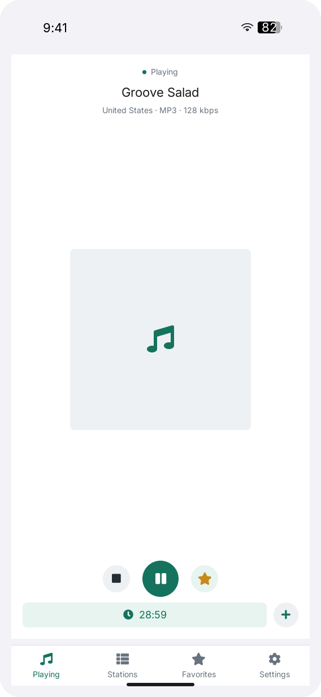
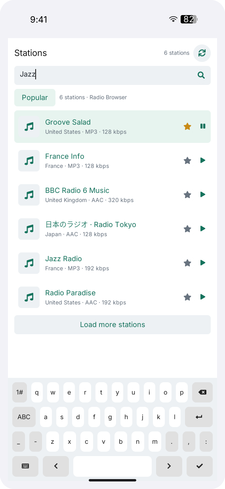

# LILYGO Radio

**English** | [简体中文](README.zh-CN.md)

LILYGO Radio is an internet radio player for LILYGO UI, built with C++17,
[LILYGO UI AppKit](https://github.com/LILYGO-UI/cm0-appkit) and LVGL 9.5.
Browse and search the [Radio Browser](https://www.radio-browser.info/) directory,
save favorite stations, set a sleep timer, or play a custom HTTP/HTTPS audio stream.

The project provides a CM0 ARM64 Linux build and an SDL2 desktop simulator
for development and testing.

## Preview

<p>
  
  
</p>

Previews use fixed test stations and AppKit system bars. See the
[UI development guidelines](docs/01-user-interface.md) for regeneration commands.

## Features

- **Station discovery:** load popular stations at startup, search by name,
  refresh, and load more results in pages of 50. Browsing does not interrupt playback.
- **Playback:** play, pause, resume, and stop stations or custom HTTP/HTTPS streams
  supported by `ffmpeg`, including MP3, AAC, and OGG audio.
- **Favorites:** save up to 256 complete station records and play them from Favorites
  across application restarts, even when the directory service is unavailable.
- **Sleep timer:** stop playback after 15, 30, 45, 60, or 90 minutes, with a countdown
  and cancellation. The timer applies to the current application session.
- **Station artwork:** download station logos in the background, reuse a local
  original-image cache, and display a default icon when artwork is unavailable.
- **Responsive interface:** Playing, Stations, Favorites, and Settings tabs;
  a portrait mini player and landscape player/list layout; an on-screen keyboard
  and desktop keyboard input, including Chinese IME commits and clipboard operations.
- **Failure handling:** loading, empty, and error states, directory server fallback,
  and four built-in SomaFM stations available before a successful directory load.

Station audio requires internet access and an available audio output device.
Saved favorites and cached logos do not provide offline audio. Artwork is the
station's logo, not the current song's album cover. See
[services and cache configuration](docs/02-services-and-cache.md) for runtime
settings, persistence behavior, and limitations.

## Development Environment

Project identity, version, and package metadata come from [`lpm.toml`](lpm.toml).
[`CMakePresets.json`](CMakePresets.json) defines the `host-simulator` and
`cm0-cross` configurations. Run all project commands from the repository root.

### Get the Source

```sh
git clone --recurse-submodules https://github.com/LILYGO-UI/lilygo-ui-radio.git
cd lilygo-ui-radio
```

For an existing checkout, initialize the pinned dependencies:

```sh
git submodule update --init --recursive
```

AppKit is consumed directly from `third_party/cm0-appkit`; a separate AppKit
installation is not required for the simulator. Its bundled LVGL 9.5.0 archive
is used by default, with network fetching disabled in both presets.

### Host Dependencies

Use CMake 3.21 or later (including CTest and CPack), Python 3.11 or later,
and a C/C++ compiler with C++17 support. The presets use Unix Makefiles;
AppKit also requires `patch` for its device-build LVGL patches.
SDL2 supplies the host display and FreeType supplies font rendering.
Radio Browser responses are parsed within the application, so neither json-c
nor libcurl development headers are required.

Network requests use the `curl` executable. `ffmpeg` decodes streams and station
artwork; Linux uses `aplay` for audio output, while macOS uses `ffplay`.
These tools must be on the application's `PATH`. Artwork render tests also
require a real `ffmpeg` executable.

#### Debian 12 / Ubuntu 24.04 or Later

```sh
sudo apt update
sudo apt install build-essential cmake git pkg-config patch libsdl2-dev \
  libfreetype6-dev curl ca-certificates ffmpeg alsa-utils \
  python3 python3-venv python3-pip
```

On older distributions, upgrade CMake and Python to the minimum versions above.
Linux playback outputs 48 kHz, 16-bit stereo PCM to the default ALSA device.

#### macOS

Install the Xcode Command Line Tools if needed and dependencies through
[Homebrew](https://brew.sh/). Complete the Homebrew shell setup so that `brew`
and its installed tools are on `PATH`:

```sh
xcode-select --install
brew install git cmake pkg-config patch sdl2 freetype curl ffmpeg python
```

Check that the installed FFmpeg distribution also provides `ffplay` with SDL
audio support; `ffmpeg` alone is insufficient for macOS playback:

```sh
ffmpeg -version
ffplay -version
```

When SDL2 is provided by SDL2-compat (reported version `2.32.50` or later),
the host input test also requires the SDL3 headers and library. Homebrew's
SDL2-compat installation normally supplies SDL3 as a dependency.

#### LPM

CMake invokes `lpm metadata --format cmake` during configuration. Install LPM
in a project-local environment using Python 3.11 or later:

```sh
python3 -m venv .venv
. .venv/bin/activate
python -m pip install "git+https://github.com/LILYGO-UI/lpm.git"
lpm --version
```

Reactivate the environment with `. .venv/bin/activate` in each new terminal
before running `lpm`. CMake searches `.venv/bin` as well as `PATH`. An existing
LPM installation can also be selected with
`-DLPM_EXECUTABLE=/absolute/path/to/lpm` during configuration.

Check the host environment before building:

```sh
cmake --version
python --version
pkg-config --modversion sdl2 freetype2
curl --version
ffmpeg -version
lpm metadata --format cmake
```

### Device Cross Compiler

Skip this step when only building the desktop simulator. Device builds need
a separate AArch64 Linux cross compiler on the development machine.

**Debian / Ubuntu:**

```sh
sudo apt install gcc-aarch64-linux-gnu g++-aarch64-linux-gnu
```

**Apple Silicon macOS:**

```sh
brew install aarch64-unknown-linux-gnu
```

The BSP toolchain expects these executable names on `PATH`:

```sh
aarch64-linux-gnu-gcc --version
aarch64-linux-gnu-g++ --version
```

See [CM0BspBuilder](https://github.com/LILYGO-UI/CM0BspBuilder) for SDK host
and compiler requirements. The BSP supplies target headers and libraries but
does not install the host cross compiler.

## Build and Test

After completing the environment setup, use LPM from the repository root.
It reads the build presets and package output directory from `lpm.toml`.

### Desktop Simulator

```sh
lpm start --foreground
```

This configures and builds the simulator, then starts it in the foreground.
To reuse an existing build, run `lpm start --no-build --foreground`.
The Debug build has tests enabled and is stored in `build/host-simulator`.
Running the application requires a graphical desktop session. Directory and
artwork downloads need working DNS, internet access, `curl`, and CA certificates;
playback also needs `ffmpeg` and the platform audio output tool described above.

### Tests

Configure and build the host simulator, then run all tests:

```sh
lpm test
```

| Test | Coverage |
| --- | --- |
| `radio-core` | URL validation, station selection, configuration and favorites persistence, and playback process management |
| `radio-browser` | Directory queries, JSON/Unicode parsing, server fallback, request limits, and cancellation |
| `radio-artwork` | Image decoding, download limits, memory/disk cache behavior, and cancellation |
| `radio-view-model` | Playback commands, directory pagination, selection preservation, sleep timer, and Subject updates |
| `radio-host-input` | Desktop text input, IME commits, selection, clipboard, and keyboard events |
| `radio-render-{portrait,landscape,mobile,compact}*` | Rendering and interactions at `568 x 1232`, `1232 x 568`, `390 x 844`, and `320 x 568` |

The host preset registers 45 tests: five behavior/input tests and 40 render tests.
Each viewport covers the player, custom-stream dialog, search, empty results,
directory error, stations, favorites, settings, sleep timer, and artwork.
Tests use fixed directory responses and controlled subprocess fixtures;
they do not require external radio services or verify live audio output.

Render tests write `radio-<viewport>[-<scenario>].ppm` under
`build/host-simulator`. Inspect the affected scenarios in all four viewports after
UI changes; passing assertions alone does not verify visual layout. See the
[UI development guidelines](docs/01-user-interface.md) for acceptance requirements
and preview generation.

### CM0 Device Build

The device preset targets CM0 Raspberry Pi OS on AArch64, uses a Release build,
disables host tests, and sets the installation prefix to `/usr`.
Cross-compile and create the Debian package:

```sh
lpm pack
```

The first `lpm pack` (or `cmake --preset cm0-cross`) uses the
[toolchain wrapper](cmake/cm0-bsp-toolchain.cmake) to download CM0 BSP `0.1.0`,
verifies its pinned SHA-256 checksum, and extracts the sysroot to
`.cache/cm0-bsp/0.1.0/sysroot`. The first download requires access to GitHub;
later configurations reuse this cache. To change the cache location, pass
`-DCM0_BSP_CACHE_DIR=/absolute/path/to/cache` when configuring.
No sibling CM0BspBuilder checkout is required.

Cross compilation needs the target FreeType and DRM libraries and headers in
the SDK sysroot. Host libraries cannot substitute for missing target dependencies.

CPack writes an ARM64 `.deb` to `dist/`. The package installs the executable,
launcher entry and icon, desktop entry, AppStream metadata, and shared-font
license notices. The target system must provide the declared dependencies,
including `lilygo-ui-appkit-dev >= 0.1.0`, `curl`, `ffmpeg`, and `alsa-utils`.
AppKit supplies shared runtime fonts on the device. Ensure CA certificates
and a working default ALSA output device are available as well.

<details>
<summary>Underlying CMake commands</summary>

LPM wraps the following steps. You can also run them directly when debugging
the build configuration; LPM is still required to read project metadata.

Host build and tests:

```sh
cmake --preset host-simulator
cmake --build --preset host-simulator --parallel
ctest --preset host-simulator
```

Device build and packaging:

```sh
cmake --preset cm0-cross
cmake --build --preset cm0-cross --parallel
cpack --config build/cm0-cross/CPackConfig.cmake -B dist
```

</details>

### Troubleshooting

| Symptom | Action |
| --- | --- |
| `lpm is required to read project metadata` | Install LPM in `.venv`, put it on `PATH`, or set `LPM_EXECUTABLE`. |
| `LilyGoUI` or bundled LVGL cannot be found | Initialize the pinned AppKit submodule with `git submodule update --init --recursive`. |
| SDL2 or FreeType is missing | Install the host development packages; for cross builds, check FreeType and DRM in the target sysroot. |
| SDL3 is missing during host test configuration | With SDL2-compat, install the SDL3 development headers and library as well. |
| Homebrew libraries are not found | Configure with `cmake --preset host-simulator -DCMAKE_PREFIX_PATH="$(brew --prefix)"`. |
| BSP download fails | Check access to GitHub releases and available disk space, then rerun configuration. |
| Stations or logos do not load | Check `curl`, CA certificates, connectivity, and `ffmpeg` for image decoding; see [services and cache](docs/02-services-and-cache.md). |
| `ffmpeg`, `aplay`, or `ffplay` is not found, or playback is silent | Check the application's `PATH`, the platform audio output tool, and the default audio device. Inspect `/tmp/lilygo-ui-radio.log`. |
| Favorites cannot be saved | Check permissions and free space at the [configuration path](docs/02-services-and-cache.md#configuration-and-favorites). |

## Documentation

| Guide | Contents |
| --- | --- |
| [Services and cache](docs/02-services-and-cache.md) | Directory and playback services, environment variables, configuration, favorites, and artwork cache |
| [Architecture overview](docs/00-overview.md) (Chinese) | Module boundaries, data flow, asynchronous work, and resource lifetimes |
| [UI development guidelines](docs/01-user-interface.md) (Chinese) | Navigation, layout, typography, desktop input, UI validation, and previews |

## Acknowledgments

Station discovery is provided by [Radio Browser](https://www.radio-browser.info/),
and the built-in fallback stations by [SomaFM](https://somafm.com/).
The interface uses LILYGO UI AppKit and [LVGL](https://lvgl.io/), with design
inspiration from [FrogRadio](https://apps.apple.com/us/app/frogradio/id1442306286).
Playback uses [FFmpeg](https://ffmpeg.org/); its process pipeline was informed by
the [T-Display-K230 launcher](https://github.com/Xinyuan-LilyGO/T-Display-K230/tree/main/k230_launcher)
and adapted to this application's AppKit lifecycle and MVVM structure.
Station streams and logos remain subject to their providers' terms.
