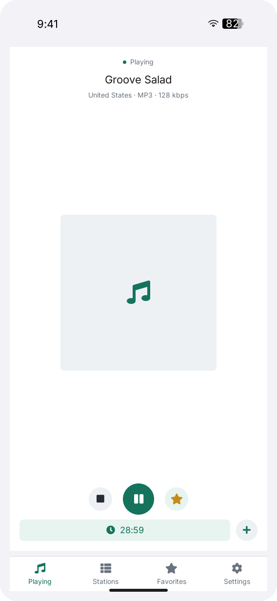
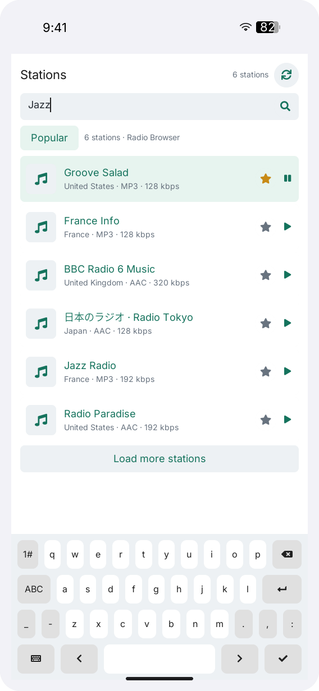

# LILYGO Radio

[English](README.md) | **简体中文**

LILYGO Radio 是面向 LILYGO UI 的网络电台播放器，基于 C++17、
[LILYGO UI AppKit](https://github.com/LILYGO-UI/cm0-appkit) 和 LVGL 9.5 构建。
支持浏览和搜索 [Radio Browser](https://www.radio-browser.info/) 电台目录、
收藏电台、设置睡眠定时，以及播放自定义 HTTP/HTTPS 音频流。

项目提供 CM0 ARM64 Linux 设备构建，以及用于开发和测试的 SDL2 桌面模拟器。

## 预览

<p>
  
  
</p>

预览使用固定测试电台和 AppKit 系统栏。
重新生成预览的命令见 [UI 开发规范](docs/01-user-interface.md)。

## 功能

- **电台发现：** 启动时加载热门电台，支持按名称搜索、刷新和分页加载，每页 50 条。
  浏览电台不会中断当前播放。
- **播放控制：** 播放、暂停、继续和停止电台或自定义 HTTP/HTTPS 音频流，
  支持 `ffmpeg` 可识别的 MP3、AAC、OGG 等音频格式。
- **收藏：** 最多保存 256 条完整电台记录，重启应用后仍可在 Favorites 中播放，
  电台目录服务暂时不可用时也能使用已有收藏。
- **睡眠定时：** 支持 15、30、45、60、90 分钟后停止播放，显示倒计时并可取消。
  定时仅在本次应用运行期间生效。
- **电台封面：** 后台下载电台 Logo，复用本地原图缓存，封面不可用时显示默认图标。
- **响应式界面：** 提供 Playing、Stations、Favorites 和 Settings 标签页，
  Playing 标签显示完整播放器，选择电台后其他标签显示迷你播放器；支持屏幕键盘和实体键盘输入，
  包括中文输入法提交和剪贴板操作。
- **异常处理：** 提供加载、空结果和错误状态，支持目录备用服务器；
  首次成功加载目录前可使用四个内置 SomaFM 电台。

电台音频播放需要网络连接和可用的音频输出设备。
已保存的收藏和缓存的 Logo 不提供离线音频。封面是电台 Logo，不是当前歌曲的专辑图。
运行时设置、持久化行为和限制详见[服务与缓存配置](docs/02-services-and-cache.md)（英文）。

## 开发环境搭建

项目标识、版本和软件包元数据由 [`lpm.toml`](lpm.toml) 提供。
[`CMakePresets.json`](CMakePresets.json) 定义了 `host-simulator` 和 `cm0-cross` 配置。
所有项目命令均在仓库根目录执行。

### 获取源码

```sh
git clone --recurse-submodules https://github.com/LILYGO-UI/lilygo-ui-radio.git
cd lilygo-ui-radio
```

已有仓库可使用以下命令初始化锁定版本的依赖：

```sh
git submodule update --init --recursive
```

项目直接使用 `third_party/cm0-appkit`，模拟器无需单独安装 AppKit。
默认使用其中附带的 LVGL 9.5.0 源码归档，两种预设均禁用了 LVGL 网络下载。

### 主机依赖

需要 CMake 3.21 或更高版本（包含 CTest 和 CPack）、Python 3.11 或更高版本，
以及支持 C++17 的 C/C++ 编译器。预设使用 Unix Makefiles；
AppKit 还需要 `patch` 来应用设备构建所需的 LVGL 补丁。
SDL2 提供主机显示，FreeType 负责字体渲染。
Radio Browser 响应由应用自行解析，因此不需要 json-c 或 libcurl 开发头文件。

网络请求使用 `curl` 可执行文件。`ffmpeg` 负责解码音频流和电台封面；
Linux 使用 `aplay` 输出音频，macOS 使用 `ffplay`。
这些工具必须位于应用的 `PATH` 中。封面渲染测试也需要真实的 `ffmpeg` 可执行文件。

#### Debian 12 / Ubuntu 24.04 或更高版本

```sh
sudo apt update
sudo apt install build-essential cmake git pkg-config patch libsdl2-dev \
  libfreetype6-dev curl ca-certificates ffmpeg alsa-utils \
  python3 python3-venv python3-pip
```

较旧发行版需要先将 CMake 和 Python 升级到上述最低版本。
Linux 播放时向默认 ALSA 设备输出 48 kHz、16 位、双声道 PCM。

#### macOS

按需安装 Xcode Command Line Tools，并通过 [Homebrew](https://brew.sh/) 安装依赖。
完成 Homebrew 的 Shell 配置，确保 `brew` 及其安装的工具位于 `PATH` 中：

```sh
xcode-select --install
brew install git cmake pkg-config patch sdl2 freetype curl ffmpeg python
```

确认所安装的 FFmpeg 发行包还提供支持 SDL 音频的 `ffplay`；
仅有 `ffmpeg` 无法在 macOS 上完成播放：

```sh
ffmpeg -version
ffplay -version
```

当 SDL2 由 SDL2-compat 提供（报告版本为 `2.32.50` 或更高）时，
主机输入测试还需要 SDL3 头文件和库。Homebrew 安装 SDL2-compat 时通常会将 SDL3 作为依赖安装。

#### LPM

CMake 在配置阶段调用 `lpm metadata --format cmake`。
使用 Python 3.11 或更高版本，在项目虚拟环境中安装 LPM：

```sh
python3 -m venv .venv
. .venv/bin/activate
python -m pip install "git+https://github.com/LILYGO-UI/lpm.git"
lpm --version
```

每次打开新终端后，先执行 `. .venv/bin/activate` 再使用 `lpm`。
CMake 会同时搜索 `.venv/bin` 和 `PATH`。
如需指定其他位置的 LPM，可在配置时传入 `-DLPM_EXECUTABLE=/absolute/path/to/lpm`。

构建前检查主机环境：

```sh
cmake --version
python --version
pkg-config --modversion sdl2 freetype2
curl --version
ffmpeg -version
lpm metadata --format cmake
```

### 设备交叉编译器

仅构建桌面模拟器时可跳过此步骤。设备构建需要在开发机上单独安装 AArch64 Linux 交叉编译器。

**Debian / Ubuntu：**

```sh
sudo apt install gcc-aarch64-linux-gnu g++-aarch64-linux-gnu
```

**Apple Silicon macOS：**

```sh
brew install aarch64-unknown-linux-gnu
```

BSP 工具链要求 `PATH` 中存在以下名称的可执行文件：

```sh
aarch64-linux-gnu-gcc --version
aarch64-linux-gnu-g++ --version
```

SDK 对主机和编译器的要求详见 [CM0BspBuilder](https://github.com/LILYGO-UI/CM0BspBuilder)。
BSP 提供目标平台的头文件和库，但不会安装开发机所需的交叉编译器。

## 构建与测试

完成环境搭建后，在仓库根目录使用 LPM。
它会从 `lpm.toml` 读取构建预设和打包输出目录。

### 桌面模拟器

```sh
lpm start --foreground
```

此命令会配置、构建模拟器，然后以前台模式启动。
如需复用已有构建产物，执行 `lpm start --no-build --foreground`。
Debug 构建启用测试，产物位于 `build/host-simulator`。
运行应用需要图形桌面会话。目录和封面下载需要正常的 DNS、网络连接、`curl` 和 CA 证书；
播放还需要 `ffmpeg` 以及前文所述的平台音频输出工具。

### 测试

配置、构建主机模拟器并运行全部测试：

```sh
lpm test
```

| 测试 | 覆盖内容 |
| --- | --- |
| `radio-core` | URL 校验、电台选择、配置和收藏持久化、播放进程管理 |
| `radio-browser` | 目录查询、JSON/Unicode 解析、备用服务器、请求限制和取消 |
| `radio-artwork` | 图像解码、下载限制、内存和磁盘缓存行为、取消 |
| `radio-view-model` | 播放命令、目录分页、选择保留、睡眠定时和 Subject 更新 |
| `radio-host-input` | 桌面文本输入、输入法提交、选择、剪贴板和键盘事件 |
| `radio-runtime-{portrait,landscape}` | 使用 SDL dummy 驱动运行完整程序，覆盖启动、反复键盘焦点维护、目录替换和正常退出 |
| `radio-render-{portrait,landscape,mobile,compact}*` | `568 x 1232`、`1232 x 568`、`390 x 844` 和 `320 x 568` 下的渲染与交互 |

主机预设注册了 47 项测试：5 项行为和输入测试、2 项完整运行时测试，以及 40 项渲染测试。
每个视口均覆盖播放器、自定义音频流弹窗、搜索、空结果、目录错误、电台列表、收藏、设置、
睡眠定时和封面。测试使用固定的目录响应和受控的子进程测试环境，
不依赖外部电台服务，也不验证真实音频输出。
运行时测试在首帧出现后保持程序运行至少一秒，覆盖渲染测试未执行的输入维护和目录轮询定时器。

渲染测试将 `radio-<viewport>[-<scenario>].ppm` 写入 `build/host-simulator`。
修改 UI 后应检查四种视口中的受影响场景；断言通过并不能验证视觉布局。
验收要求和预览生成说明见 [UI 开发规范](docs/01-user-interface.md)。

### CM0 设备构建

设备预设面向 AArch64 架构的 CM0 Raspberry Pi OS，使用 Release 构建，
禁用主机测试，并将安装前缀设为 `/usr`。交叉编译并生成 Debian 软件包：

```sh
lpm pack
```

首次执行 `lpm pack`（或 `cmake --preset cm0-cross`）时，
[工具链包装脚本](cmake/cm0-bsp-toolchain.cmake)会下载 CM0 BSP `0.1.0`，
校验锁定的 SHA-256，并将 sysroot 解压到 `.cache/cm0-bsp/0.1.0/sysroot`。
首次下载需要访问 GitHub，后续配置会复用缓存。
如需修改缓存位置，可在配置时传入 `-DCM0_BSP_CACHE_DIR=/absolute/path/to/cache`。
无需在相邻目录克隆 CM0BspBuilder。

交叉编译需要 SDK sysroot 中的目标平台 FreeType 和 DRM 库及头文件。
主机库不能替代缺失的目标平台依赖。

CPack 将 ARM64 `.deb` 输出到 `dist/`。软件包安装可执行文件、启动器条目及图标、
桌面条目、AppStream 元数据和共享字体许可声明。
目标系统需要提供声明的依赖，包括 `lilygo-ui-appkit-dev >= 0.1.0`、`curl`、`ffmpeg` 和 `alsa-utils`。
AppKit 在设备上提供共享运行时字体。还应确保 CA 证书和默认 ALSA 输出设备可用。

<details>
<summary>底层 CMake 命令</summary>

LPM 封装了以下步骤。调试构建配置时也可以直接执行这些命令，但读取项目元数据仍需要 LPM。

主机构建与测试：

```sh
cmake --preset host-simulator
cmake --build --preset host-simulator --parallel
ctest --preset host-simulator
```

设备构建与打包：

```sh
cmake --preset cm0-cross
cmake --build --preset cm0-cross --parallel
cpack --config build/cm0-cross/CPackConfig.cmake -B dist
```

</details>

### 常见问题

| 现象 | 处理方法 |
| --- | --- |
| `lpm is required to read project metadata` | 在 `.venv` 中安装 LPM，将其加入 `PATH`，或设置 `LPM_EXECUTABLE`。 |
| 找不到 `LilyGoUI` 或附带的 LVGL | 执行 `git submodule update --init --recursive`，初始化锁定版本的 AppKit 子模块。 |
| 缺少 SDL2 或 FreeType | 安装主机开发依赖；交叉编译时检查目标 sysroot 中的 FreeType 和 DRM。 |
| 配置主机测试时缺少 SDL3 | 使用 SDL2-compat 时，还需安装 SDL3 开发头文件和库。 |
| 找不到 Homebrew 库 | 使用 `cmake --preset host-simulator -DCMAKE_PREFIX_PATH="$(brew --prefix)"` 配置。 |
| BSP 下载失败 | 检查 GitHub Releases 访问情况和可用磁盘空间，然后重新配置。 |
| 电台或 Logo 无法加载 | 检查 `curl`、CA 证书、网络连接，以及用于图像解码的 `ffmpeg`，详见[服务与缓存](docs/02-services-and-cache.md)（英文）。 |
| 找不到 `ffmpeg`、`aplay` 或 `ffplay`，或播放无声 | 检查应用的 `PATH`、平台音频输出工具和默认音频设备，并查看 `/tmp/lilygo-ui-radio.log`。 |
| 无法保存收藏 | 检查[配置路径](docs/02-services-and-cache.md#configuration-and-favorites)（英文）的权限和可用空间。 |

## 文档

| 指南 | 内容 |
| --- | --- |
| [服务与缓存](docs/02-services-and-cache.md)（英文） | 目录与播放服务、环境变量、配置、收藏和封面缓存 |
| [架构概览](docs/00-overview.md)（中文） | 模块边界、数据流、异步任务和资源生命周期 |
| [UI 开发规范](docs/01-user-interface.md)（中文） | 导航、布局、字体、桌面输入、UI 验证和预览 |
| [启动闪退排查](docs/03-startup-crash.md)（中文） | 实体键盘焦点修复、完整运行时回归测试和实机验证 |

## 致谢

电台发现服务由 [Radio Browser](https://www.radio-browser.info/) 提供，
内置备用电台由 [SomaFM](https://somafm.com/) 提供。
界面使用 LILYGO UI AppKit 和 [LVGL](https://lvgl.io/)，
设计参考了 [FrogRadio](https://apps.apple.com/us/app/frogradio/id1442306286)。
播放使用 [FFmpeg](https://ffmpeg.org/)；进程管线参考了
[T-Display-K230 启动器](https://github.com/Xinyuan-LilyGO/T-Display-K230/tree/main/k230_launcher)，
并适配了本应用的 AppKit 生命周期和 MVVM 结构。
电台音频流和 Logo 的使用仍需遵守各提供方的相关条款。
